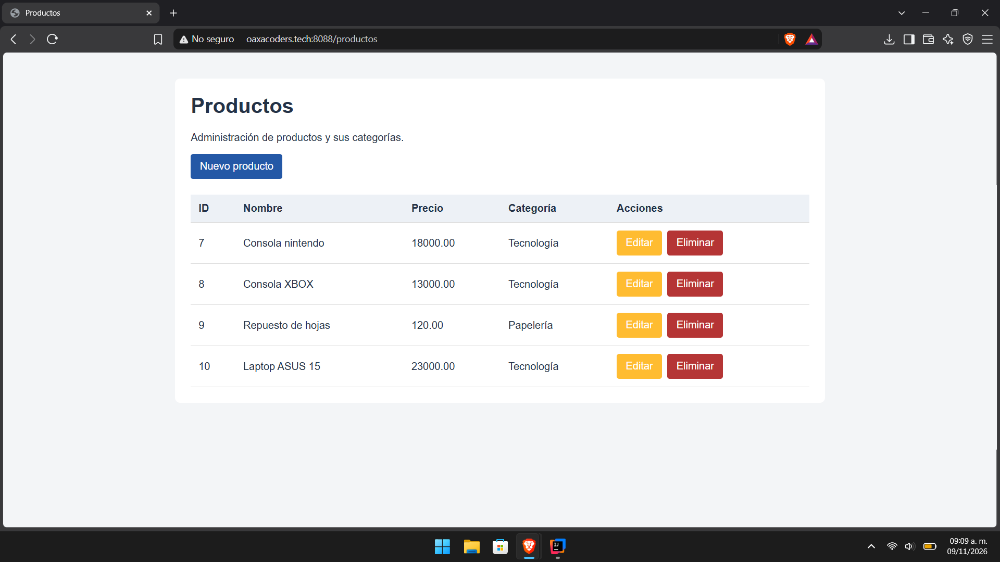
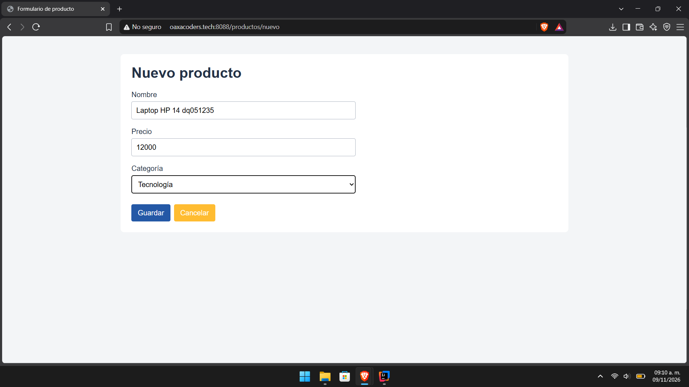
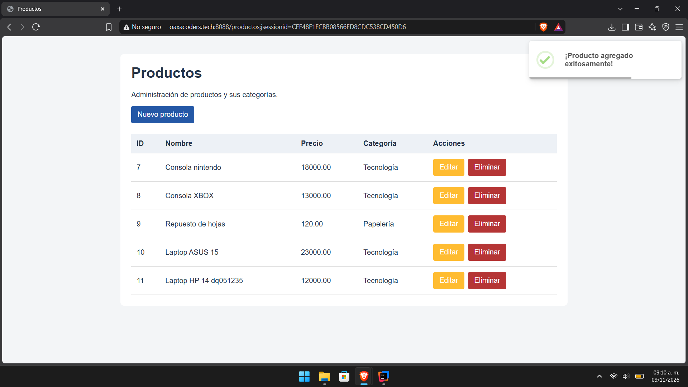
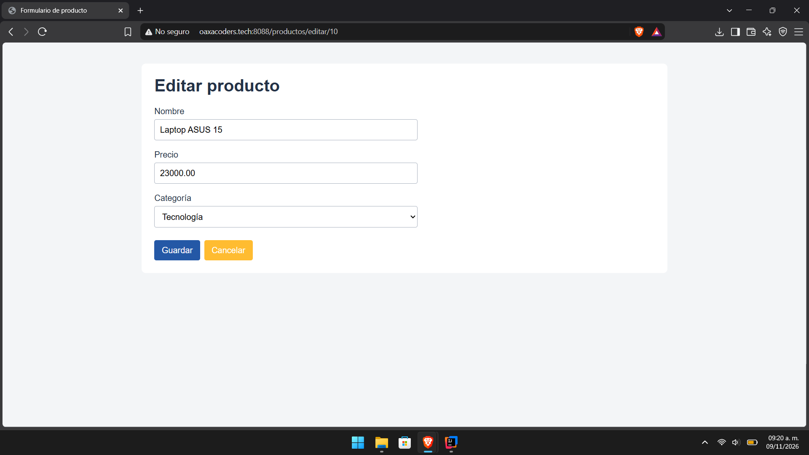
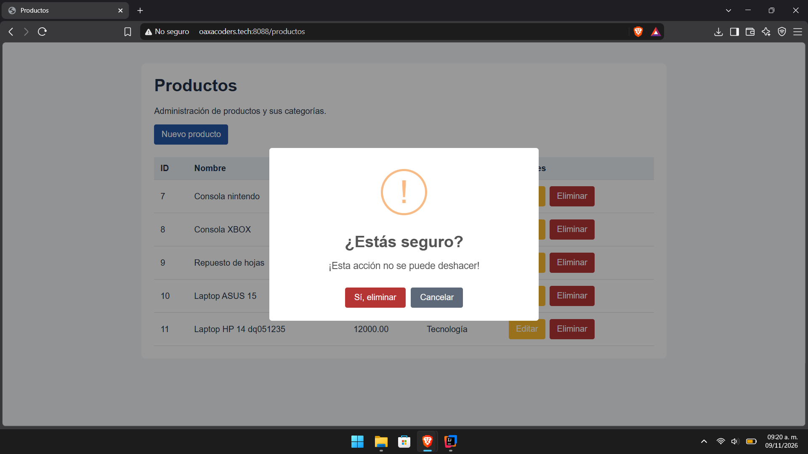
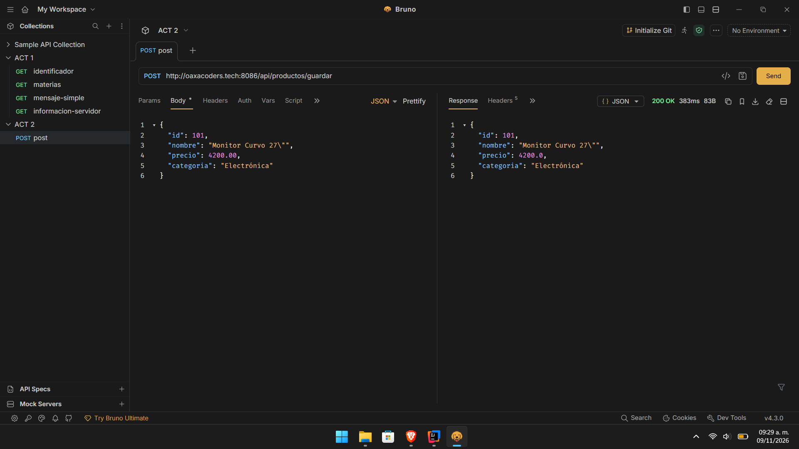

# Actividad 3: CRUD en Spring Boot con Relaciones

Aplicación web desarrollada con arquitectura por capas (Model, Repository, Service, Controller) que implementa un CRUD completo para la gestión de entidades relacionadas (`Producto` y `Categoria`) mediante una relación `@ManyToOne`, utilizando Spring Boot, Spring Data JPA, Thymeleaf, MariaDB/MySQL y notificaciones flotantes con SweetAlert2.

---

##  Estructura de la Base de Datos y Relación
El sistema gestiona dos entidades principales conectadas mediante una relación relacional:
* **`Categoria`**: Entidad principal que agrupa los productos.
* **`Producto`**: Entidad dependiente que contiene una clave foránea hacia Categoria (`@ManyToOne`).
---

##  Evidencias y Capturas de Pantalla del Sistema

### 1. Vista Principal y Listado de Productos (CRUD)
*Interfaz principal donde se enlistan los registros actuales obtenidos de la base de datos, mostrando la relación de categorías y los botones de acción (Editar y Eliminar).*

---

### 2. Formulario de Registro con Alertas Modernas (SweetAlert2)
*Formulario interactivo para la creación y edición de productos, integrando validaciones y notificaciones flotantes de éxito al completar la transacción.*

---

### 3. Diálogo de Confirmación para Eliminar Registro
*Interfaz implementada con SweetAlert2 para prevenir eliminaciones accidentales al hacer clic en el botón de eliminación de un producto.*

### 4. Método POST 
*Prueba del método guardar mediante Bruno para verificar que la API procesa la solicitud y devuelve una respuesta correcta.*

